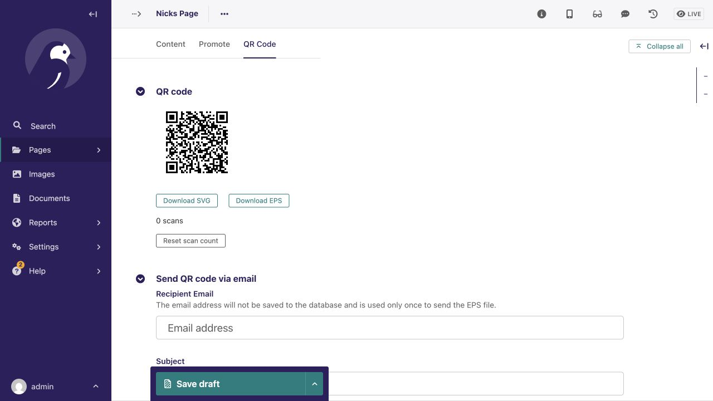

# Wagtail QR code

Create QR codes that link to Wagtail pages. Codes use the page ID, so they keep
working when a page is renamed or moved.

- Preview QR codes and download SVG or EPS files.
- Email an EPS when saving a draft or publishing.
- Count scan redirects and reset counts in the editor.
- Give copies, translations and aliases their own codes and counts.

QR files are generated on demand, without Wagtail Documents or stored assets.



## Upgrading from v2.1.1 (read this first)

Upgrading from 2.1.1 requires application changes and a planned data migration.
Follow the [upgrade guide](docs/upgrading.md) to preserve scan counts, keep
printed codes working and update your site's integrations before deploying.

## Installation

Use one of these supported combinations:

| Wagtail | Django | Python |
| --- | --- | --- |
| 7.4 LTS, 8.0, 8.1 | 5.2 LTS | 3.11–3.14 |
| 7.4 LTS, 8.0, 8.1 | 6.0 | 3.12–3.14 |
| 8.0 | 6.1 | 3.12–3.14 |
| 8.1 | 6.1 | 3.12–3.15 |

Use the latest patch releases. Python 3.14 requires Django 5.2.8+ on the 5.2
series; Python 3.15 requires Django 6.1.3+.

```bash
pip install wagtail-qrcode
```

Add the app and QR base URL to your Django settings:

```python
INSTALLED_APPS = [
    # ...
    "wagtail_qrcode",
]

WAGTAIL_QR_CODE_BASE_URL = "https://example.com"
```

The base URL defaults to `WAGTAILADMIN_BASE_URL` when the QR setting is omitted.
Add the scan route before `wagtail_urls` in your site's URL configuration:

```python
from django.urls import include, path

urlpatterns = [
    # ...
    path("qr-code/", include("wagtail_qrcode.urls")),
    # ... Wagtail routes
]
```

Run `python manage.py migrate` to create the scan-counter table.

## Page model

Add `QRCodeMixin` to a page model:

```python
from wagtail.admin.panels import (
    FieldPanel,
    MultiFieldPanel,
    ObjectList,
    TabbedInterface,
)
from wagtail.models import Page

from wagtail_qrcode.admin_forms import QrCodeEmailForm
from wagtail_qrcode.models import QRCodeMixin


class QRCodePage(QRCodeMixin, Page):
    qrcode_panels = QRCodeMixin.panels + [
        MultiFieldPanel(
            [
                FieldPanel("email_address"),
                FieldPanel("email_subject"),
                FieldPanel("email_body"),
            ],
            heading="Send QR code via email",
        )
    ]

    edit_handler = TabbedInterface(
        [
            ObjectList(Page.content_panels, heading="Content"),
            ObjectList(Page.promote_panels, heading="Promote"),
            ObjectList(Page.settings_panels, heading="Settings", classname="settings"),
            ObjectList(qrcode_panels, heading="QR Code", classname="qr-code"),
        ]
    )

    base_form_class = QrCodeEmailForm
```

For an existing model, keep its content, promote and settings panels.
Without email, use `qrcode_panels = QRCodeMixin.panels` and omit the
`QrCodeEmailForm` import and `base_form_class`.

Run `python manage.py makemigrations` and `python manage.py migrate` for your
page model.

## Using the editor

Save a new page to enable the **QR Code** tab's preview, **Download SVG** and
**Download EPS** controls. These require admin access and permission to edit
the page, including drafts.

**Reset scan count** asks for confirmation and resets the count immediately.
It preserves unsaved edits, creates no revision or email, and cannot be undone
by restoring a revision. The button is disabled at zero.

To email an EPS, enter a recipient, check the subject and body, then choose
**Save draft** or **Publish**. Both message fields are required with a recipient.
Email fields are not stored with the page; the recipient starts blank when
reopening the editor. Delivery happens after the save transaction commits.
Autosave, later workflow approval and scheduled publication do not repeat it.

For aliases, use **Preview QR code**, **Download QR SVG** and **Download QR EPS**
in the header's **Actions** menu. These use the alias's own ID.

## Scans and counts

The example route encodes `https://example.com/qr-code/?id=123`. Custom mount
paths work too; direct view wiring must use the name `qr_code_page_view`.

Only live QR pages redirect. Missing, invalid, unknown, unpublished and non-QR
page IDs return 404 without changing counts. Private pages still enforce access
at the destination. Counts measure redirects, including access prompts, rather
than unique visitors or confirmed views.

The first successful scan creates a counter record. Drafts and revisions share
the page's QR identity; restoring a revision leaves its count alone. Copies,
translations and aliases, including chained aliases, have independent counts.
Deleting a page deletes its counter.

Keep the encoded domain and route reachable after printing. Configuration
changes affect new output, not printed codes. Database exports that remap page
IDs do not preserve QR identities automatically.

## Configuration

These optional Django settings show the defaults:

```python
WAGTAIL_QR_CODE = {
    "scale": 3,
    "quiet_zone": 6,
    "svg_has_xml_declaration": False,
}
WAGTAIL_QRCODE_EMAIL_SUBJECT = "Your QR code"
WAGTAIL_QRCODE_EMAIL_BODY = "Please find your QR code attached as an EPS file."
```

`scale` sets dot size; `quiet_zone` sets the border width.
SVG always includes its XML namespace. Changes apply to the next preview,
download or email.

Email defaults are plain text, without template substitution. Custom field
initials override settings; constructor `initial=` values override both.
Empty strings, callables, disabled fields and custom form cleaning are respected.
Invalid submissions retain entered values.
`wagtail_qrcode.wagtail_hooks.send_qr_code_email()` uses the same defaults
when subject or body is omitted.

### Public preview

Render a QR code in a page template:

```html


```

Unsaved pages produce no output. In Python, use
`WagtailQrCode(page).render("svg")` or `.render("eps")` from
`wagtail_qrcode.cls`; both return bytes.

## Try it locally

Follow the [contributor setup](docs/contrubute.md#setup), then run:

```bash
just sandbox-setup
just sandbox-run
```

Open <http://localhost:8000/>; the initial admin login is `admin` / `admin`.
See the [sandbox guide](docs/sandbox.md) for email capture and phone testing,
and the [smoke tests](docs/smoke-tests.md) for manual checks.

## Contributing and issues

[Contributions](docs/contrubute.md) are welcome. Branch from `main`, target PRs
at `main`, and prepare and tag releases there.

[Raise an issue](https://github.com/nm-packages/wagtail-qrcode/issues) if you find a problem.
